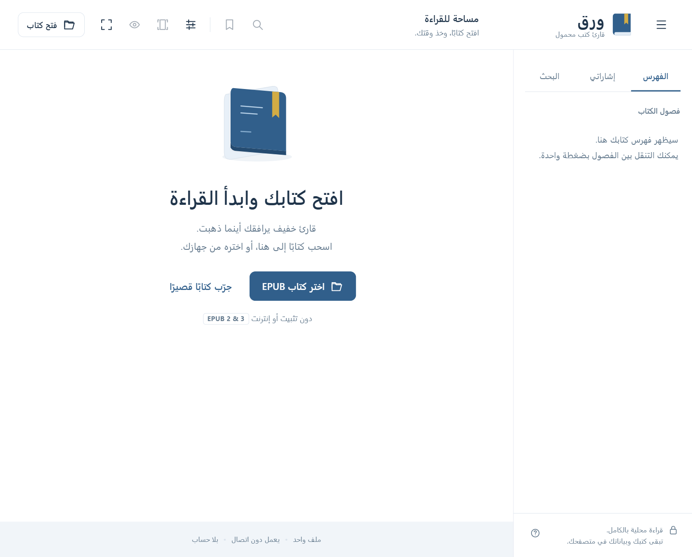

# Waraq · ورق

**A lightweight, portable, offline-first EPUB reader with Arabic-first reading support.**

One HTML file. No install, no server, no account, no tracking.

[](https://github.com/yasserBadr/Waraq/actions/workflows/ci.yml)
[](https://github.com/yasserBadr/Waraq/releases/latest)


[**Open the reader**](https://yasserbadr.github.io/Waraq/) · [Download the latest release](https://github.com/yasserBadr/Waraq/releases/latest) · [Changelog](CHANGELOG.md) · [العربية](#العربية)



## Why Waraq

- **Truly portable.** The entire application is a single `Waraq.html` file. Copy it to a USB stick, a shared folder, or a phone and open it in a browser.
- **Arabic-first.** The interface is Arabic and RTL, while books can be Arabic, English, or mixed. Reading direction follows each book's language and spine.
- **Offline by design.** No CDN, no fonts, no analytics, no book uploads. The page's Content Security Policy blocks remote resources.
- **No installation.** EPUB.js and JSZip are bundled into the HTML file; there is nothing to `npm install` just to read a book.
- **Your data stays yours.** Reading positions, bookmarks, and settings live in your browser's local storage, not on a server.

## Features

**Reading**

- EPUB 2 and EPUB 3, including RTL and LTR books.
- Three layouts: continuous scrolling (default), A4 portrait pages, and screen-sized pages.
- Chapter table of contents, full-text search, bookmarks, and resume.
- Light, sepia, and dark themes.
- Adjustable font size, font family, and line height.
- Focus mode, fullscreen, drag and drop, and keyboard shortcuts.
- Built-in short Arabic demo book for a one-click trial.

**Portability and privacy**

- Last-book cache (optional) so you can continue without picking the file again.
- Export and import reading data as JSON to move positions and bookmarks between devices.
- Book content is sanitized: scripts, iframes, forms, event handlers, and external resources are blocked.
- No network requests, no accounts, and no telemetry.

**Format support**

- Supported: unprotected EPUB 2 and EPUB 3.
- Not supported: PDF, MOBI, and DRM-protected books. Waraq does not remove DRM.

## Quick start

### Use it online

Open **<https://yasserbadr.github.io/Waraq/>**. The reader runs entirely in your browser; no book is uploaded.

### Use it offline

1. Download `Waraq-Portable-1.3.zip` from [Releases](https://github.com/yasserBadr/Waraq/releases/latest).
2. Extract the archive anywhere, including a USB drive.
3. Open `Waraq.html` in Chrome or Edge. On Windows you can also run `Open-Waraq.cmd`.
4. Choose an EPUB, drag one into the window, or click **جرّب كتابًا قصيرًا** for the demo.

### Build from source

```sh
python src/build.py
node scripts/check.mjs
python scripts/package.py
```

Open `dist/Waraq.html` in a browser. Python 3.10+ and Node.js 18+ are required for development only; the built reader has no runtime dependencies.

## Keyboard shortcuts

| Action | Shortcut |
| --- | --- |
| Next / previous chapter in scroll mode; next / previous page in paged modes | `←` / `→` (direction-aware) |
| Scroll down / up | `Space`, `PageDown` / `PageUp` |
| Start / end of chapter (scroll mode) | `Home` / `End` |
| Toggle bookmark | `B` |
| Search the book | `/` |
| Focus mode / exit focus mode | `F` / `Esc` |
| Browser fullscreen | `F11` |

Shortcuts are ignored while typing in an input or while a dialog is open.

## Privacy and security

- Waraq makes **no network requests** at runtime. Books, fonts, scripts, and styles are all local.
- The Content Security Policy is `default-src 'none'` with only the minimum required exceptions for inline styles/scripts and local blobs.
- Book HTML is sanitized before display. Scripts, iframes, forms, event handler attributes, and external links are removed.
- The reader enforces a 100 MB file limit, a 400 MB uncompressed-content limit, and a 15,000-entry limit.
- Reading data is stored in `localStorage` under `waraq-v1`; the optional last-book cache uses IndexedDB (`waraq-local`).
- Private browsing may discard data when the window closes. Some browsers restrict storage for `file://` pages.
- When moving to another browser, device, or folder, export your reading data first and import it on the other side. Book files are not included in the JSON export.

## Compatibility

- **Tested:** Google Chrome and Microsoft Edge on Windows, desktop and a 390 px responsive layout.
- **Expected to work:** recent Chromium-based browsers, Firefox, and Safari. They are not part of the current test matrix.
- **Limits:** books with fixed layouts, custom embedded fonts, or encrypted resources may render differently. Arabic fonts depend on the fonts installed on the device.
- **Search:** plain text search, first 80 results. Arabic diacritics are not normalized automatically.
- **Progress:** approximate, based on spine index and displayed pages, not printed page numbers.

See [docs/TESTED.txt](docs/TESTED.txt) for the verification notes and their limits.

## Project structure

```text
src/index.html        UI, styles, and application logic (editable source)
src/build.py          deterministic build into dist/
src/vendor/           EPUB.js 0.3.93 and JSZip 3.10.1 with their licenses
scripts/check.mjs     JavaScript, data-validation, navigation, and CSP checks
scripts/package.py    reproducible portable ZIP builder
dist/                 built single-file reader, demo book, user docs
docs/                 user guide, test summary, README screenshot
.github/workflows/    CI verification and GitHub Pages deployment
VERSION               single source of truth for the release version
```

`work/` and `releases/` are generated and ignored by Git.

## Development

```sh
# Build dist/Waraq.html and the demo book
python src/build.py

# Run the automated checks (requires Node.js)
node scripts/check.mjs

# Build the portable release ZIP in releases/
python scripts/package.py

# Preview locally
python -m http.server 8000 --directory dist
# then open http://localhost:8000/Waraq.html
```

The build is deterministic: fixed ZIP timestamps make the EPUB, the HTML file, and the release ZIP byte-for-byte reproducible. CI rebuilds the project and fails if `dist/` differs from the committed output.

See [CONTRIBUTING.md](CONTRIBUTING.md) for the review guidelines and the expected test steps.

### Tests

`scripts/check.mjs` verifies that:

- all bundled scripts parse;
- malformed reading-data imports are rejected;
- settings are bounded and old settings migrate correctly;
- EPUB CFIs and bookmarks survive a JSON round trip;
- scrolling and paged navigation behave correctly;
- the build has no remote scripts, stylesheets, or placeholders;
- the Arabic source uses logical Unicode order without bidi control characters.

Visual checks, the native file picker, drag and drop, and export/import flows still need manual verification in a real browser. The test summary records what was and was not verified.

## Deployment

The repository includes two GitHub Actions workflows:

- **CI** (`.github/workflows/ci.yml`) builds the app, runs the checks, packages the release, and confirms that `dist/` is current.
- **Pages** (`.github/workflows/pages.yml`) rebuilds the app and publishes `dist/` to GitHub Pages. The workflow copies `Waraq.html` to `index.html` in the deployed artifact, so the root URL opens the reader directly.

## Releasing

1. Update `VERSION`.
2. Run `python src/build.py`, `node scripts/check.mjs`, and `python scripts/package.py`.
3. Commit the source and rebuilt `dist/` files.
4. Tag and publish:

```sh
git tag -a v1.3 -m "Waraq 1.3"
git push origin main --tags
gh release create v1.3 releases/Waraq-Portable-1.3.zip --title "Waraq 1.3" --generate-notes
```

## Third-party licenses

Waraq bundles:

- [EPUB.js](https://github.com/futurepress/epub.js) 0.3.93 — see `src/vendor/EPUBJS-LICENSE.txt`.
- [JSZip](https://github.com/Stuk/jszip) 3.10.1, used under the MIT option of its dual license — see `src/vendor/JSZIP-LICENSE.txt`.

The full texts are also included in `dist/THIRD-PARTY-LICENSES.txt` and inside the standalone HTML file. Keep them when redistributing the reader.

No standalone license has been declared for the Waraq application code yet. If you want to reuse it, please open an issue to discuss licensing.

---

## العربية

**ورق** قارئ EPUB خفيف ومحمول بواجهة عربية. التطبيق كله ملف HTML واحد يعمل دون تثبيت أو خادم أو اتصال بالإنترنت.

**ابدأ الآن:** افتح [النسخة المنشورة](https://yasserbadr.github.io/Waraq/) أو نزّل `Waraq-Portable-1.3.zip` من [الإصدارات](https://github.com/yasserBadr/Waraq/releases/latest)، ثم افتح `Waraq.html` في Chrome أو Edge.

**المزايا**

- دعم EPUB 2 وEPUB 3 والكتب العربية والإنجليزية واتجاهي RTL وLTR.
- قراءة بالتمرير، أو صفحات A4، أو صفحات بحجم مساحة القراءة.
- فهرس، بحث، إشارات مرجعية، واستعادة موضع القراءة.
- أوضاع نهاري وورقي وليلي، وتحكم في الخط وحجمه وتباعده.
- وضع التركيز وملء الشاشة والسحب والإفلات واختصارات لوحة المفاتيح.
- تصدير واستيراد بيانات القراءة لنقل المواضع والإشارات بين الأجهزة.
- حفظ محلي بالكامل: لا تُرفع الكتب ولا بيانات القراءة إلى أي خدمة.

**حدود النسخة:** لا يدعم PDF أو MOBI أو إزالة حماية DRM. الحد الأقصى لملف الكتاب 100 ميجابايت. راجع [دليل الاستخدام](docs/README.txt) و[ملخص التحقق](docs/TESTED.txt) للتفاصيل.

**التطوير**

```sh
python src/build.py
node scripts/check.mjs
python scripts/package.py
```

المتطلبات: Python 3.10+ وNode.js 18+ للبناء والفحص فقط. الملف الناتج `dist/Waraq.html` مستقل تمامًا.

**البنية:** `src/index.html` هو المصدر القابل للتعديل، و`src/vendor/` يحوي EPUB.js وJSZip وتراخيصهما، و`dist/` النسخة المبنية، و`docs/` التوثيق.

**التراخيص:** تراخيص المكتبات المضمّنة محفوظة في `src/vendor/` و`dist/THIRD-PARTY-LICENSES.txt`. لم يُحدَّد ترخيص عام مستقل لكود التطبيق بعد.
